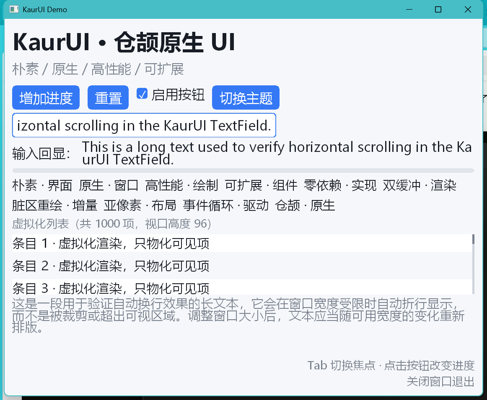

# KaurUI

[](https://cangjie-lang.cn/)
[]()
[](LICENSE)

**English** | [中文](README.md)

**KaurUI** is a **native Windows GUI library** for the [Cangjie](https://cangjie-lang.cn/) programming language. It uses no web toolchain and no third-party UI framework: it talks to Win32 / GDI through C interop, and implements the widget tree, layout, event dispatch and rendering pipeline in Cangjie itself.



## Goals

- **Plain** — no animation system, no CSS-like style engine; only layout + paint + events
- **Native** — real Win32 windows, message loop and GDI drawing; logical coordinates mapped to physical pixels
- **Fast** — double buffering, dirty-region repaint, measurement cache, list virtualization with widget recycling, clip-aware culling
- **Extensible** — `Widget` and `Renderer` are public interfaces; third parties can add widgets or swap the rendering backend

## Features

### Widgets

| Widget | Description |
|---|---|
| `Panel` | Vertical/horizontal container with `spacing`, main/cross alignment, padding, background, `flex` |
| `WrapPanel` | Flow container that wraps lines (tag clouds) |
| `ScrollView` | Vertical scrolling container (wheel, scrollbar, clipping) |
| `ListView` | Virtualized list: fixed or variable heights (`heightProvider`), widget recycling pool (`binder`) |
| `Label` | Single-line or wrapping text, alignment, font size, bold, color |
| `Button` | Normal / hover / pressed / disabled states, `onClick` |
| `CheckBox` | Checked drawing, `onChange`, space-key toggle |
| `TextField` | Caret and selection, `Shift`-extend, `Ctrl+A/C/X/V`, horizontal scrolling, `onSubmit` |
| `ProgressBar` | 0..1 progress, clamped |
| `Image` | BMP/ICO with `Fill`, `Contain`, `Cover` fitting |
| `Spacer` / `SizedBox` | Flexible spacer / fixed-size box |

### Platform

- Per-Monitor-V2 DPI awareness; layout uses logical pixels
- Minimum window size (`WM_GETMINMAXINFO`), hand cursor, mouse wheel, hover cleanup on deactivation
- System clipboard (CF_UNICODETEXT) read/write
- Light/dark themes, runtime `App.setTheme` / `App.setRoot`

### Performance mechanisms

| Mechanism | Implementation |
|---|---|
| Double buffering | Memory DC + bitmap reused by size, committed with `BitBlt` |
| Dirty-region repaint | Widget-level invalidation rects merged, only intersecting areas repainted |
| Measurement cache | Key = constraints + children content version sum |
| Clip-aware culling | Containers skip subtrees that do not intersect `currentClip` |
| List virtualization | Only the visible range (plus overscan) is materialized; widgets recycled while scrolling |
| Text measurement cache | Keyed by `text + font size + bold`; GDI call count observable |

All mechanisms expose observable counters (`drawCalls`, `layoutCount`, `measure`, `cacheHits`, `skips`, `builtCount`, `builderCalls`) for benchmarking and regression checks.

## Architecture

```
kaurui.app          Application: AppBuilder, event dispatch, focus, theme, invalidation
   ↓
kaurui.widget       Widgets: Widget trait, containers, controls, theme
   ↓                ↘
kaurui.layout     Layout engine    kaurui.render   Renderer interface + GDI backend
   ↓                ↙
kaurui.platform     Platform: window, message loop, DPI, clipboard, cursor
   ↓
kaurui.ffi          Win32 binding: runtime symbol resolution, @C structs, UTF-16, constants
```

## Quick start

### Requirements

- Windows x64
- Cangjie toolchain **1.2.0** (cjnative), `cjc` target `x86_64-w64-mingw32`
- No MinGW installation and no extra gdi32/d2d1 import libraries are required (the library resolves symbols at runtime)

### Build and run

```powershell
# Add the Cangjie toolchain to PATH (adjust to your installation)
$env:PATH = "D:\Program Files (x86)\Cangjie\tools\bin;D:\Program Files (x86)\Cangjie\bin;D:\Program Files (x86)\Cangjie\runtime\lib\windows_x86_64_cjnative;" + $env:PATH

cjpm build                 # build library and demo
cjpm test                  # unit tests (130 cases)
cjpm run --name demo       # run the demo
```

### Demo environment variables

| Variable | Effect |
|---|---|
| `KAURUI_AUTOCLOSE_MS=1200` | Close the window after N milliseconds (for automation) |
| `KAURUI_START_DARK=1` | Start with the dark theme |
| `KAURUI_IMAGE=<path.bmp>` | Insert a BMP image into the UI |
| `KAURUI_AUTO_CHANGE=1` | Mutate text after startup to observe incremental layout |

## Minimal example

```cangjie
import kaurui.app.*
import kaurui.layout.*
import kaurui.widget.*

main(): Int64 {
    let theme = Theme.light()
    let progress = ProgressBar(value: 0.0f32)

    let root = Panel(
        [
            Label("KaurUI", fontSize: 24.0f32, bold: true),
            Button("Add progress", onClick: { => progress.setValue(progress.value + 0.1f32) }),
            progress
        ],
        axis: MainAxis.Vertical,
        spacing: 12.0f32,
        padding: Insets.all(20.0f32)
    )

    AppBuilder
        .create()
        .title("KaurUI Demo")
        .size(640, 420)
        .minSize(480, 320)
        .theme(theme)
        .root(root)
        .run()
}
```

## Repository layout

```
KaurUI/
├── cjpm.toml              # workspace: kaurui + demo
├── kaurui/
│   ├── cjpm.toml          # static library
│   └── src/
│       ├── ffi/           # Win32 binding (symbols, structs, constants, UTF-16)
│       ├── platform/      # window, message loop, DPI, clipboard
│       ├── render/        # Renderer interface + GDI implementation
│       ├── layout/        # geometry, constraints, stack layout solver
│       ├── widget/        # widgets, theme, layout statistics
│       └── app/           # AppBuilder, event dispatch, invalidation
├── demo/
│   └── src/main.cj        # demo application
└── docs/demo.png          # screenshot
```

## Implementation notes

- **No import libraries**: the Cangjie SDK ships only 16 MinGW import libraries (no `gdi32`, `d2d1`, `ole32`), so every Win32/GDI function is resolved at runtime via `LoadLibrary` + `GetProcAddress`; failures raise an exception containing the DLL and symbol name.
- **No `CFunc` captures**: Cangjie `CFunc` lambdas cannot capture variables, so window procedures dispatch through a global `HWND → Window` table.
- **Logical coordinates**: GDI `MM_ANISOTROPIC` maps logical pixels to physical pixels; DPI scaling happens in the renderer, layout only deals with logical pixels.
- **Threading**: the message loop owns one Cangjie thread; avoid blocking or yielding while holding the window. Cross-thread work goes through posted messages.

## Known limitations

- Windows only
- Images limited to BMP / ICO (`LoadImageW`); no PNG decoder
- Text input is ASCII-only; IME (e.g. Chinese) is not supported yet
- No animation, transforms, multiple windows, or accessibility support
- Containers are currently `Panel` / `WrapPanel` / `ScrollView` / `ListView`; `Stack` and `Grid` are planned

## License

[Apache License 2.0](LICENSE)

## Contributing

Issues and pull requests are welcome. Before submitting, make sure:

```powershell
cjpm build
cjpm test
```

both pass, and run `cjfmt` on new production code.
