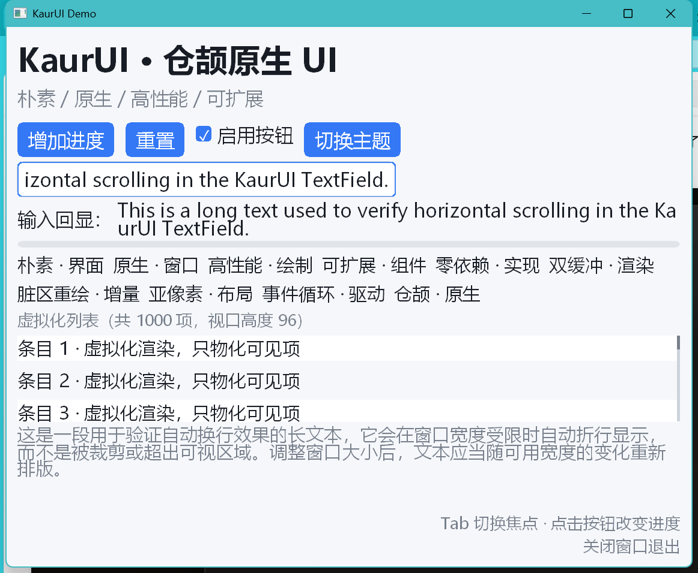

# KaurUI

[](https://cangjie-lang.cn/)
[]()
[](LICENSE)

[English](README.en.md) | **中文**

**KaurUI** 是面向仓颉（Cangjie）语言的 **Windows 原生 GUI 库**。它不依赖 Web 工具链、不引入第三方 UI 框架，直接通过 C 互操作调用 Win32 / GDI，用仓颉实现控件树、布局、事件与渲染管线。



## 设计目标

- **朴素**：没有动画系统、没有 CSS 式样式引擎，只有必需的布局 + 绘制 + 事件
- **原生**：窗口、消息循环、绘制全部走 Win32 API，逻辑坐标由 GDI 映射到物理像素
- **高性能**：双缓冲、脏区重绘、测量缓存、列表虚拟化与控件复用、裁剪感知跳过
- **可扩展**：`Widget` 与 `Renderer` 均为公开接口，第三方可自行扩展控件与渲染后端

## 特性

### 控件

| 控件 | 说明 |
|---|---|
| `Panel` | 纵向/横向容器，支持 `spacing`、主轴/交叉轴对齐、内边距、背景、`flex` |
| `WrapPanel` | 流式折行容器（标签云等） |
| `ScrollView` | 垂直滚动容器（滚轮、滚动条、裁剪） |
| `ListView` | 虚拟化列表：定高 / 变高（`heightProvider`）、控件复用池（`binder`） |
| `Label` | 单行 / 自动换行（`wrap`）、对齐、字号、加粗、颜色 |
| `Button` | 常态 / hover / pressed / disabled 四态，`onClick` |
| `CheckBox` | 勾选绘制、`onChange`、空格键切换 |
| `TextField` | 光标与选区、`Shift` 扩选、`Ctrl+A/C/X/V`、水平滚动、`onSubmit` |
| `ProgressBar` | 0..1 进度，越界自动钳制 |
| `Image` | BMP/ICO，`Fill` / `Contain` / `Cover` 等比适配 |
| `Spacer` / `SizedBox` | 弹性占位 / 固定尺寸盒 |

### 平台能力

- Per-Monitor-V2 DPI 感知，布局使用逻辑像素
- 窗口最小尺寸（`WM_GETMINMAXINFO`）、手型光标、滚轮、失焦清理 hover
- 系统剪贴板（CF_UNICODETEXT）读写
- 深色 / 浅色主题切换，`App.setTheme` / `App.setRoot` 支持运行时替换

### 性能机制

| 机制 | 实现 |
|---|---|
| 双缓冲 | 内存 DC + 位图按尺寸复用，`BitBlt` 整帧提交 |
| 脏区重绘 | 控件级失效矩形合并 → 只重绘相交区域 |
| 测量缓存 | 约束 + 子节点版本和作为键，未变化子树直接命中 |
| 绘制裁剪感知 | 容器跳过与 `currentClip` 不相交的子树 |
| 列表虚拟化 | 只物化可见区间（含 overscan），滚动复用控件 |
| 文本度量缓存 | `text + 字号 + 粗体` 为键，GDI 调用次数可观测 |

上述机制都暴露了观测字段（`drawCalls` / `layoutCount` / `measure` / `cacheHits` / `skips` / `builtCount` / `builderCalls`），便于压测与回归。

## 架构

```
kaurui.app          应用层：AppBuilder、事件分发、焦点、主题、脏区调度
   ↓
kaurui.widget       控件层：Widget trait、容器、基础控件、主题
   ↓                ↘
kaurui.layout    布局引擎      kaurui.render   渲染抽象 + GDI 实现
   ↓                ↙
kaurui.platform     平台层：窗口、消息循环、DPI、剪贴板、光标
   ↓
kaurui.ffi          Win32 绑定：运行期符号解析、@C 结构体、UTF-16、常量
```

## 快速开始

### 环境

- Windows x64
- 仓颉工具链 **1.2.0**（cjnative），`cjc` 目标为 `x86_64-w64-mingw32`
- 无需安装 MinGW，也无需额外的 gdi32/d2d1 导入库（库内使用运行期符号解析）

### 构建与运行

```powershell
# 将仓颉工具链加入 PATH（按实际安装路径调整）
$env:PATH = "D:\Program Files (x86)\Cangjie\tools\bin;D:\Program Files (x86)\Cangjie\bin;D:\Program Files (x86)\Cangjie\runtime\lib\windows_x86_64_cjnative;" + $env:PATH

cjpm build                 # 构建库与示例
cjpm test                  # 单元测试（130 个用例）
cjpm run --name demo       # 运行示例程序
```

### 示例环境变量（仅 demo）

| 变量 | 作用 |
|---|---|
| `KAURUI_AUTOCLOSE_MS=1200` | N 毫秒后自动关闭窗口（便于自动化验证） |
| `KAURUI_START_DARK=1` | 以深色主题启动 |
| `KAURUI_IMAGE=<path.bmp>` | 在界面插入一张 BMP 图像 |
| `KAURUI_AUTO_CHANGE=1` | 启动后自动修改文本，用于观测增量布局 |

## 最小示例

```cangjie
import kaurui.app.*
import kaurui.layout.*
import kaurui.widget.*

main(): Int64 {
    let theme = Theme.light()
    let progress = ProgressBar(value: 0.0f32)

    let root = Panel(
        [
            Label("KaurUI", fontSize: 24.0f32, bold: true),
            Button("增加进度", onClick: { => progress.setValue(progress.value + 0.1f32) }),
            progress
        ],
        axis: MainAxis.Vertical,
        spacing: 12.0f32,
        padding: Insets.all(20.0f32)
    )

    AppBuilder
        .create()
        .title("KaurUI Demo")
        .size(640, 420)
        .minSize(480, 320)
        .theme(theme)
        .root(root)
        .run()
}
```

## 目录结构

```
KaurUI/
├── cjpm.toml              # workspace：kaurui + demo
├── kaurui/
│   ├── cjpm.toml          # 静态库
│   └── src/
│       ├── ffi/           # Win32 绑定（符号解析、结构体、常量、UTF-16）
│       ├── platform/      # 窗口、消息循环、DPI、剪贴板
│       ├── render/        # Renderer 接口 + GDI 实现
│       ├── layout/        # 几何、约束、Stack 布局求解
│       ├── widget/        # 控件、主题、布局缓存统计
│       └── app/           # AppBuilder、事件与脏区调度
├── demo/
│   └── src/main.cj        # 示例程序
└── docs/demo.png          # 截图
```

## 关键实现说明

- **零导入库依赖**：仓颉 SDK 仅随附 16 个 mingw 导入库（无 `gdi32`/`d2d1`/`ole32`），因此所有 Win32/GDI 函数都在运行期通过 `LoadLibrary` + `GetProcAddress` 解析，缺失时抛出带 DLL 与符号名的异常。
- **无 `CFunc` 捕获**：仓颉的 `CFunc` lambda 不能捕获变量，窗口过程统一通过 `HWND → Window` 全局表分发。
- **逻辑坐标**：GDI `MM_ANISOTROPIC` 将逻辑像素映射到物理像素，DPI 缩放在绘制层完成，布局层只处理逻辑像素。
- **线程约束**：消息循环独占一个仓颉线程，持有窗口期间避免阻塞或让出，跨线程一律走消息投递。

## 已知限制

- 仅支持 Windows；未适配其他平台
- 图像仅支持 BMP / ICO（`LoadImageW`），无 PNG 解码
- 文本输入仅 ASCII，暂不支持 IME 中文输入
- 无动画、变换、多窗口、无障碍支持
- 布局容器目前为 `Panel` / `WrapPanel` / `ScrollView` / `ListView`，`Stack` 与 `Grid` 尚在规划中

## 许可证

[Apache License 2.0](LICENSE)

## 贡献

欢迎提交 Issue 与 Pull Request。提交前请确保：

```powershell
cjpm build
cjpm test
```

均通过，并对新增生产代码执行 `cjfmt`。
